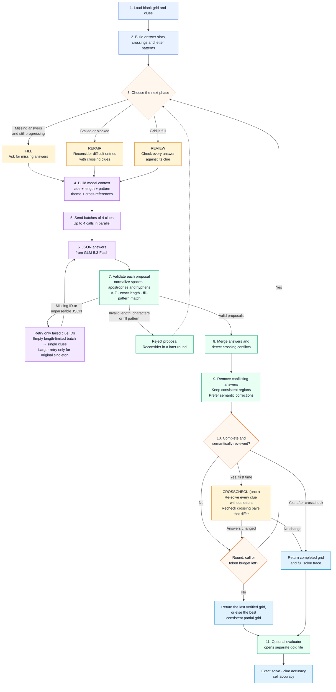
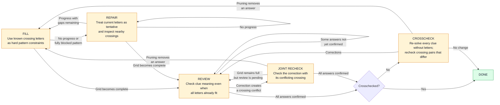
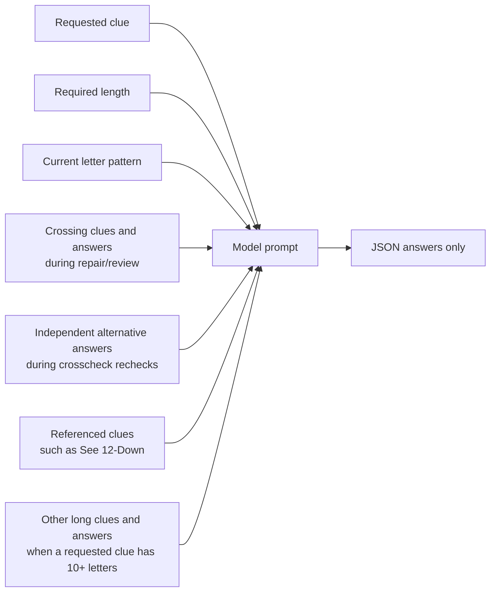
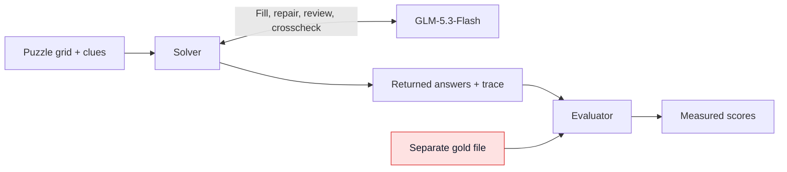

# How the AI Agent Solves a Crossword

GLM-5.3-Flash handles fill, repair, semantic review and crosscheck. Python controls the solve, checks every proposal and decides what to reconsider. All requests share one call/token budget; the model never sees gold.

## Complete solving flow

## What happens inside each phase

### Fill

- Requests only unanswered clues.
- Uses existing crossing letters as required pattern letters.
- Rejects wrong lengths, invalid characters and pattern violations.

### Repair

- Activates when progress stops or a fully determined pattern is rejected.
- Sends difficult missing entries together with their crossing clues.
- Treats existing letters as tentative so an earlier wrong answer can be replaced.
- Jointly rechecks a semantic correction and any answer that conflicts with it.
- Returns to fill after making progress with gaps remaining; stays in repair after no progress.

### Review

- Runs after the grid has an answer for every clue.
- Asks GLM to confirm clue meaning instead of trusting crossings alone.
- Prevents a rejected answer from immediately returning through fill mode.
- GLM immediately rechecks a semantic correction with any conflicting crossing answer.
- If pruning removes an answer, the next round fills the resulting gap.

The reviewer can be overridden with `--review-model`. If it differs from the solver, answers changed by a solver-side joint repair need confirmation by that reviewer in a later review round. This optional path was used only for an [exploratory trial](EVALUATION.md#exploratory-reviewer-trial); GLM review remains the default and the basis of the main evaluation.

### Crosscheck

A crossing pair can agree letter for letter and still be wrong when one wrong shared letter is absorbed by both answers. Review alone often accepts such a pair, because each answer looks plausible next to the other.

- Runs once, after the grid is first verified, whenever review is on.
- GLM re-solves every clue without crossing letters, in batches of four, as a crossing-free second opinion. A blank answer only means the model has no confident answer without letters.
- Flags a crossing pair when an independent answer differs from the grid answer in one or two letters, including the shared cell.
- Rechecks up to eight flagged pairs jointly, showing the current answers and the independent alternatives.
- Reviews every changed answer again, together with any crossing answer whose shared letter changed, before the grid is accepted.
- Submits the last verified grid if the rounds or the token budget run out before that.
- Records its status: `completed`, `incomplete` (some clues got no answer because a request hit the output limit, the budget or a transport failure), `skipped` (no round left) or `not_reached` (the grid was never verified).

### Retry and budget control

- Immediately retries missing IDs and responses that cannot be parsed.
- Rejects invalid characters, lengths and fill-pattern violations; the next round can reconsider those clues.
- Retries an empty length-limited batch directly as individual clues instead of recursively creating intermediate batches.
- Does not give a split-generated singleton another 12,000-token attempt.
- Preserves one larger retry for a request that started as a singleton.
- Records each returned response, final error and provider usage report in the solve trace.
- Summarizes transient HTTP retries with `http_attempts` rather than storing each intermediate HTTP error.
- Records the requested and served model names for every response, with usage under the shared budget.

## Prompt context sent to the model

The model never receives the gold solution. Gold remains outside the solving loop and is opened only after `solve()` returns.

## Gold boundary

## Code responsibilities

| Component | File | Responsibility |
|---|---|---|
| Puzzle | `src/puzzle.py` | Load and validate the grid; build slots, patterns and crossings |
| Model client | `src/llm_client.py` | Call Nebius Token Factory; enforce call/token budgets and HTTP retries; record the serving model |
| Solver | `src/solver.py` | Run fill, repair, review, crosscheck, validation, pruning and tracing; `batch_size`, `repair`, `review` and `crosscheck` arguments support ablations |
| Configuration | `src/config.py` | Reported defaults shared by the client, solver, CLI and demo |
| Evaluator | `src/evaluator.py` | Compare returned answers with gold after inference |
| Demo | `app.py` | Show live solving or replay a recorded run |
| CLI | `run_eval.py` | Run one puzzle, optionally evaluate it and save the full result |
| Benchmark | `run_benchmark.py`, `analyze_benchmark.py` | Run configurations × puzzles × repeated runs with resumable, hash-checked results; report puzzle-level statistics |
| Memorization probe | `scripts/probe_memorization.py` | Ask for answers from puzzle identity and slot lengths only |

The reported app and CLI configuration uses 15 rounds, up to 200 HTTP attempts and a 400,000 reported-token threshold per puzzle. The round limit is configurable up to 30. New requests stop at the token threshold; requests already in flight can take reported usage slightly above it. The controller uses no answer retrieval, candidate beam or constraint-satisfaction solver. The same model solves and reviews, so a plausible wrong answer can survive review. Only the separate evaluator comparing against gold can establish an exact solve.
